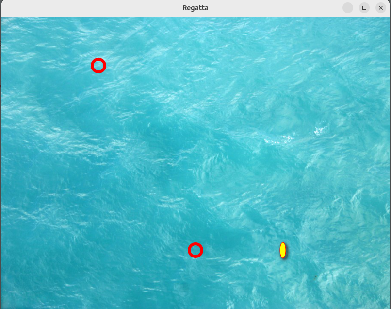

# Regatta Project



## Project Description

This project contains an example of a graphical application written in Java using the JavaFX graphics library.  
It is based on the Model-View-Presenter (MVP) architectural pattern.

The project is managed using the 'gradle' build system.

## Project Organization

The project has the following structure:

## Project Structure

```bash
.
├── build.gradle
├── coding-style.xml
├── doc
│   ├── delivrable1
│   │   ├── cas_utilisation.jpg
│   │   ├── config_game.png
│   │   ├── delivrable1.md
│   │   ├── diagramme_classe_metier.png
│   │   ├── finish_game.png
│   │   └── playing_game.png
│   └── delivrable2
│       └── delivrable2.md
├── gradle
│   └── wrapper
│       ├── gradle-wrapper.jar
│       └── gradle-wrapper.properties
├── gradle.properties.ci
├── gradlew
├── gradlew.bat
├── LICENSE
├── README.md
├── scripts
│   └── pre-commit
├── settings.gradle
└── src
    ├── main
    │   ├── java
    │   │   └── fr
    │   │       └── ensicaen
    │   │           └── genielogiciel
    │   │               └── project
    │   │                   ├── Main.java
    │   │                   ├── model
    │   │                   │   ├── BoatModel.java
    │   │                   │   ├── Bouee.java
    │   │                   │   ├── ConcreteCoast.java
    │   │                   │   ├── ConcreteGame.java
    │   │                   │   ├── ConcreteWind.java
    │   │                   │   ├── Direction.java
    │   │                   │   ├── DoubleCrew.java
    │   │                   │   ├── FigaroBoat.java
    │   │                   │   ├── FigaroFactory.java
    │   │                   │   ├── IBoatFactory.java
    │   │                   │   ├── IBoat.java
    │   │                   │   ├── ICoast.java
    │   │                   │   ├── IDecoratorEquipment.java
    │   │                   │   ├── IDecoratorSail.java
    │   │                   │   ├── IGame.java
    │   │                   │   ├── IWeather.java
    │   │                   │   ├── IWind.java
    │   │                   │   ├── LargeSail.java
    │   │                   │   ├── MediumSail.java
    │   │                   │   ├── PlayerModel.java
    │   │                   │   ├── PolarTable.java
    │   │                   │   ├── PrevisionMeteoAPI.java
    │   │                   │   ├── SingleCrew.java
    │   │                   │   ├── TimeScore.java
    │   │                   │   └── WeatherAPI.java
    │   │                   ├── presenter
    │   │                   │   ├── ConcreteGamePresenter.java
    │   │                   │   ├── GamePresenter.java
    │   │                   │   ├── IGameView.java
    │   │                   │   ├── ILoginView.java
    │   │                   │   ├── Ipresenter.java
    │   │                   │   ├── LoginPresenter.java
    │   │                   │   └── UserAction.java
    │   │                   └── view
    │   │                       ├── GameView.java
    │   │                       ├── LoginView.java
    │   │                       └── MainController.java
    │   └── resources
    │       └── fr
    │           └── ensicaen
    │               └── genielogiciel
    │                   └── project
    │                       ├── images
    │                       │   └── water.jpg
    │                       ├── MessageBundle_en_US.properties
    │                       ├── MessageBundle.properties
    │                       └── view
    │                           ├── LoginDialog.css
    │                           ├── LoginDialog.fxml
    │                           ├── MainView.fxml
    │                           ├── SpotMap.css
    │                           └── SpotMap.fxml
    └── test
        └── java
            └── fr
                └── ensicaen
                    └── genielogiciel
                        └── project
                            └── model
                                ├── BoueeTest.java
                                ├── ConcreteCoastTest.java
                                ├── CrewModifierContractTest.java
                                ├── DirectionTest.java
                                ├── DoubleCrewTest.java
                                ├── FigaroTest.java
                                ├── LargeSailTest.java
                                ├── MediumSailTest.java
                                ├── SingleCrewTest.java
                                ├── TimeScoreTest.java
                                └── WeatherAPITest.java

31 directories, 73 files
```
## Team

### Project Manager

- Benoît Cheramy

### Git Maintener

- Abraão Albuquerque
- Mohamed Abdessalame

### Architect

- Abdessalame Mohamed
- Abderrahmane Kabar

### Devs Team

- Abraão Albuquerque
- Mohamed ElBoukhiari
- Lucie Dai
- Eymen Bouhlel
- Joris Moczygeba


