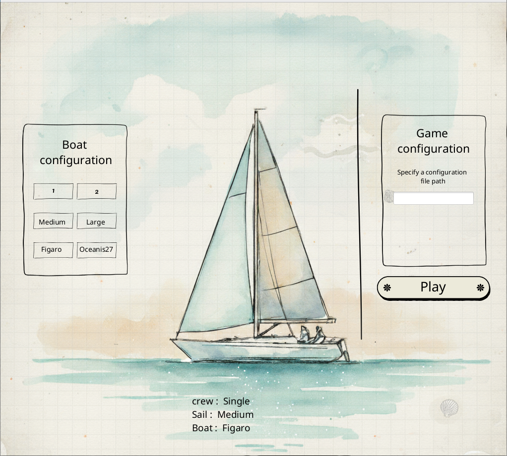
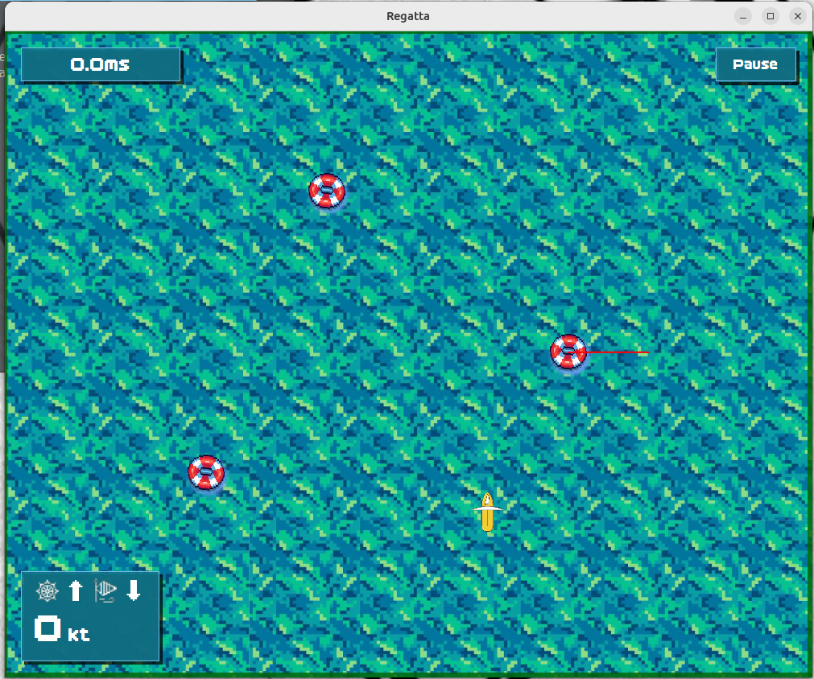
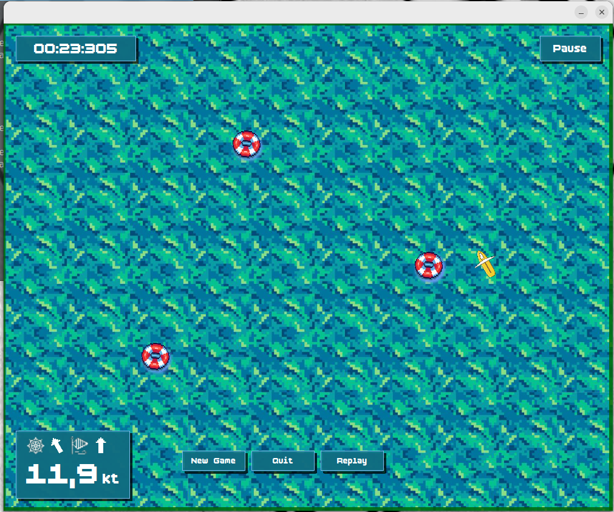

# Regatta Project – Version 1.0.0







## Project Description

This project is a graphical application developed in Java using the JavaFX framework.
It follows the Model–View–Presenter (MVP) architectural pattern to ensure:

- Clear separation of concerns

-  Easy maintenance

- Long-term scalability

The project is built and managed with Gradle, offering efficient dependency management and automated build workflows.

## Key Features :
Major Visual Update :

- Complete redesign of the user interface

- Modernized graphical components

- Improved layout consistency and visual hierarchy

- New Menu System

- Replay


## Run
```bash
./gradlew run
```


## Project Organization

## Team

### Project Manager

- Benoît Cheramy

### Git Maintainers

- Abdessalame Mohamed
- Abraão Albuquerque

### Architects

- Abdessalame Mohamed
- Abderrahmane Kabar

### Development Team

- Abraão Albuquerque
- Mohamed ElBoukhiari
- Lucie Dai
- Eymen Bouhlel
- Joris Moczygeba
