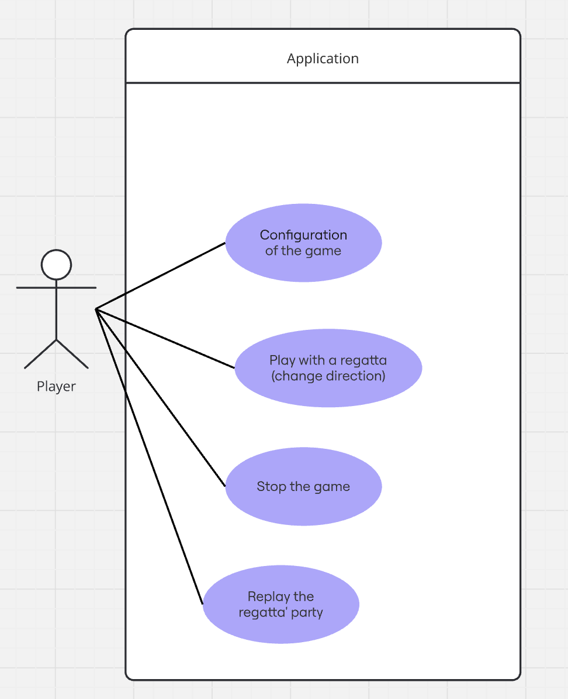
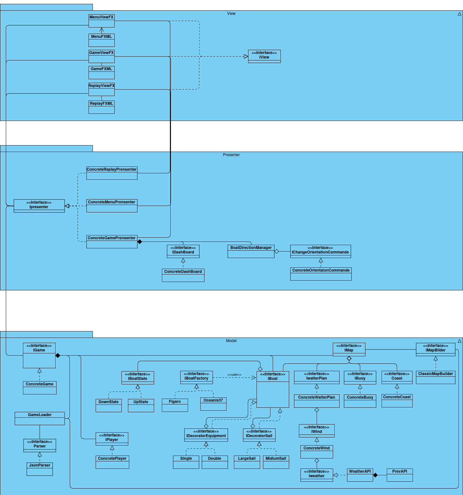
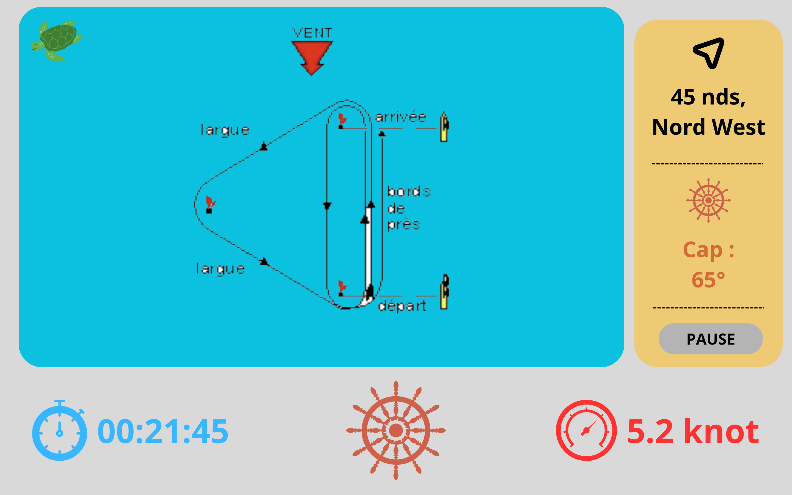
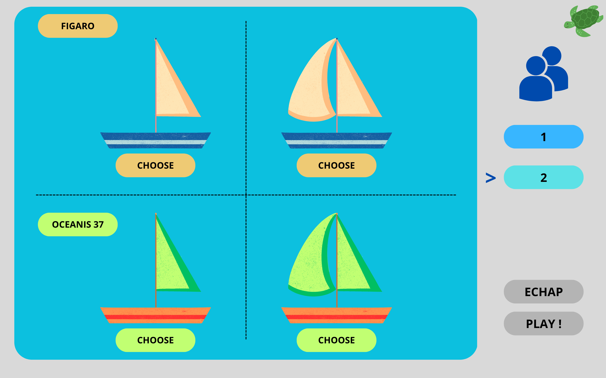
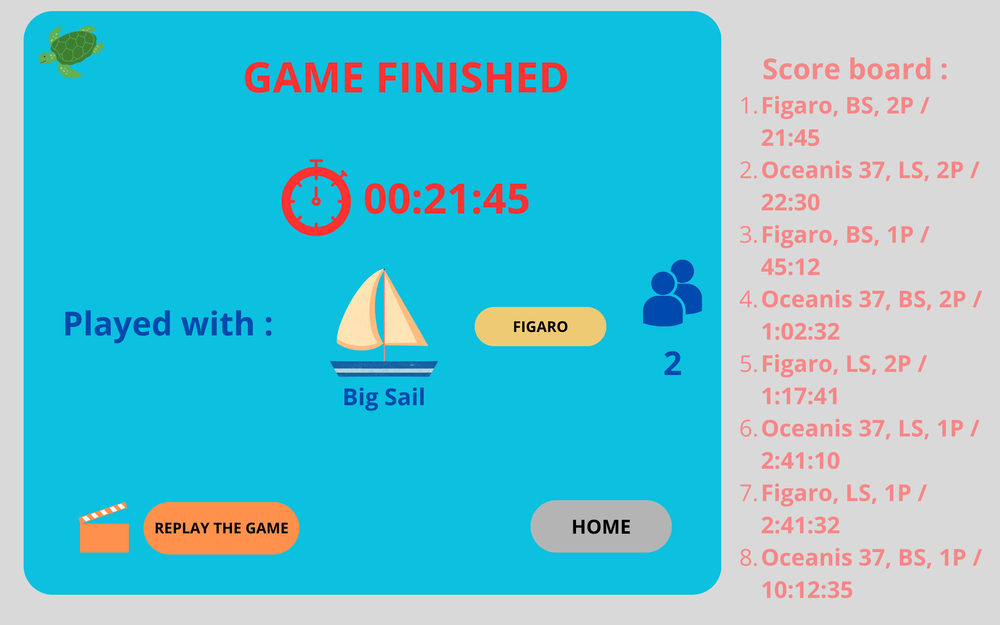

# Livrable n°1

## Identification du projet

- **Nom du projet** : Jeu de régate  
- **Équipe** : Mohamed Abdessalame, Abraão Albuquerque, Eymen Bouhlel, Benoît Cheramy, Lucie Dai, Mohamed ElBoukhiari, Abderrahmane Kabar, Joris Moczygeba

## Diagramme des cas d'utilisation

Le diagramme de cas d'utilisation ci-contre montre uniquement les interactions possibles entre le joueur et l'application.

## Diagramme de classes métier

## Maquettes des futurs écrans

## Analyse des risques projet

### Risques techniques

- **Complexité de la modélisation physique** (polaire des vitesses, vent, déplacement)  
  - *Prévention* : Prototyper le moteur de simulation tôt, valider les formules avec des tests simples avant l'intégration à l'interface.  
- **Difficulté d'intégration de JavaFX**  
  - *Prévention* : Séparer la logique du jeu et l'affichage (architecture MVVM), tester chaque partie indépendamment.  
- **Problèmes de compatibilité ou de configuration** (Gradle, CI/CD, JDK)  
  - *Prévention* : Figer les versions des outils dans `build.gradle`.  
- **Absence de tests unitaires et de CI fiables**  
  - *Prévention* : Intégrer JUnit dans le cycle de développement et automatiser les tests via GitLab CI.  
- **Indisponibilité de l'API météo**  
  - *Prévention* : Prévoir un mode “offline” avec des valeurs par défaut.  

### Risques liés au groupe

- **Manque de communication ou de coordination entre les membres**  
  - *Prévention* : Réunions régulières, utilisation stricte des branches et merge requests sur GitLab.  
- **Mauvaise répartition des tâches ou surcharge d’un membre**  
  - *Prévention* : Répartition claire des rôles (PM, Architecte, Devs), suivi de l’avancement par le chef de projet, utilisation d’un tableau Kanban.  
- **Non-respect des délais (sessions de TP limitées)**  
  - *Prévention* : Planification par jalons et priorisation des fonctionnalités essentielles.  
- **Manque d’expérience sur les outils imposés**  
  - *Prévention* : Apprentissage rapide par tutoriels et partage des connaissances entre membres.  