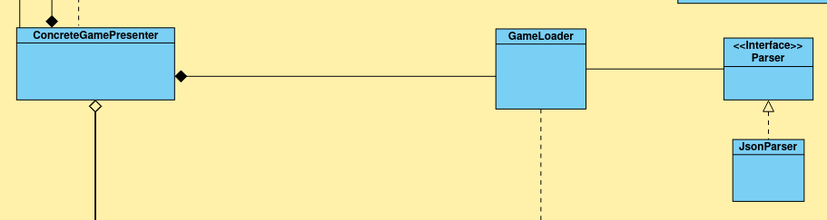
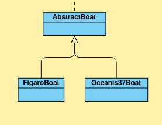
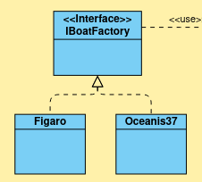
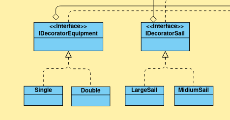
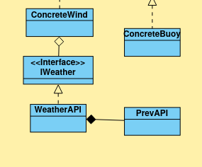
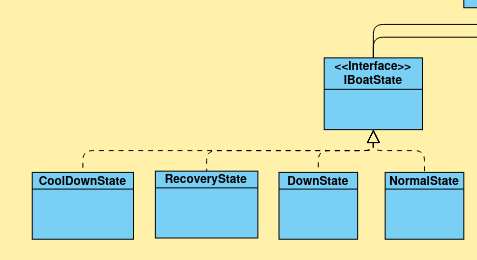
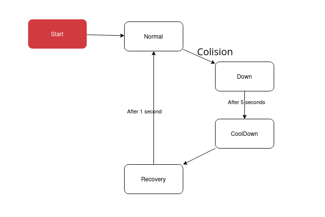
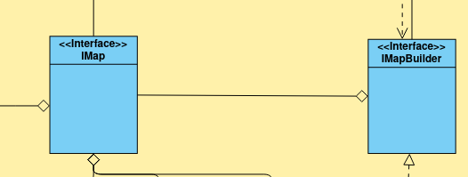
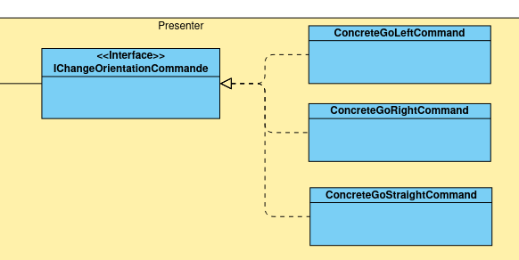
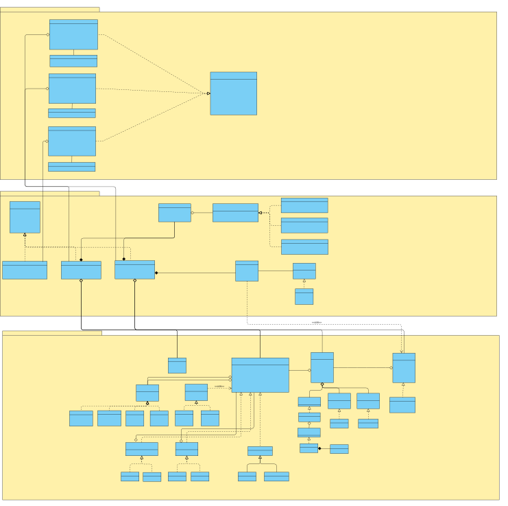

# Rapport final

## 1. Identification du projet

- Nom du projet&nbsp;:

- Équipe&nbsp;: 

## 2. Position du problème

Comment avez-vous envisagé le problème ?

## 3. Modèle de solution

### Motivation
L'objectif primordial de ce projet ne se limite pas à la simple réalisation d'un jeu fonctionnel. La demande explicite du client porte sur la conception d'un logiciel **robuste, maintenable et extensible**. Une attention particulière a donc été accordée à la qualité du code, en appliquant scrupuleusement les **principes SOLID** et en respectant les règles de l'art du développement logiciel.

### Technologies et Contraintes
Le cadre de réalisation du projet est défini par un ensemble de contraintes technologiques strictes imposées par le cahier des charges. Ces choix structurent notre environnement de développement :

* **Langage de programmation :** JAVA (pour la robustesse et l'orientation objet).
* **Interface Graphique :** JavaFX (imposé pour le rendu visuel).
* **Gestion de projet et Build :** Gradle (pour l'automatisation de la production).
* **Versionning et Collaboration :** Git et GitLab (avec un workflow d'Intégration Continue CI/CD).
* **Assurance Qualité :** Tests unitaires via JUnit et Mockito.

### Architecture Globale
Pour répondre à ces exigences de maintenabilité et pour organiser efficacement les interactions entre les technologies citées ci-dessus, nous avons structuré notre application autour du pattern architectural **MVP (Modèle-Vue-Présenteur)**. Ce choix permet de découpler totalement la logique métier de l'interface graphique JavaFX.

### Analyse critique et Méthodologie
Cette section présente l'élaboration détaillée de la solution technique retenue. Afin de garantir une adéquation parfaite avec les attentes du client, nous avons adopté une démarche analytique : chaque exigence du cahier des charges a été étudiée pour en déterminer les implications techniques et structurelles.

C'est cette traduction des besoins fonctionnels en choix architecturaux concrets (Design Patterns) que nous détaillons dans les parties suivantes.
##### A) Initialisation du plan d'eau et du parcours via un fichier de configuration

Pour initialiser une partie, le moteur de jeu doit charger la configuration du plan d'eau. Ce fichier de configuration définit les éléments statiques de l'environnement, à savoir :

* Le tracé du trait de côte (les obstacles fixes).
* Les coordonnées géographiques des bouées délimitant le parcours.
* La position initiale (point de départ) du bateau.

Afin de respecter le principe de **faible couplage**, notre programme doit être capable de charger une partie indépendamment du format de fichier utilisé (JSON, XML, CSV, etc.). Il est donc nécessaire d'abstraire la logique de lecture des données.

Pour répondre à cette problématique, nous avons mis en œuvre le **Patron de Conception Stratégie (Strategy Pattern)**. Ce pattern permet d'isoler l'algorithme de parsing : la classe `GameLoader` ne sait pas comment lire le fichier, elle délègue cette tâche à une interface `Parser`. Ainsi, seul l'objet concret (ici `JsonParser`) change selon l'extension du fichier, sans impacter le reste du code.

Le diagramme UML ci-dessous illustre l'implémentation de ce pattern au sein de notre architecture :

##### B) Calcul de la vitesse basé sur une polaire des vitesses spécifique à chaque bateau.

La vitesse du voilier dépend intrinsèquement de ses caractéristiques physiques (modèle, type de voile, équipage). Il est donc nécessaire de **découpler** la logique générale de calcul des spécificités propres à chaque configuration.

**Le type de bateau et la méthode Template :**

Le modèle du bateau (ex: Figaro ou Oceanis) détermine la manière dont il réagit au vent via sa **table polaire**. Bien que les données de cette table soient uniques pour chaque navire, le processus de chargement et d'utilisation de ces données suit une logique identique.

Pour répondre à ce besoin, nous avons utilisé le **Patron de Méthode (Template Method)**. Ce pattern nous permet de définir le squelette de l'algorithme de chargement dans une classe mère abstraite, tout en laissant les sous-classes redéfinir certaines étapes spécifiques (comme le chemin du fichier de la tableau correspondant).

Comme nous avons plusieurs méthodes en commun (gestion de la position, calcul vectoriel), ce pattern évite la duplication de code tout en garantissant que chaque bateau initialise correctement ses propres données de performance.

Le diagramme UML ci-dessous illustre l'implémentation de ce pattern au sein de notre architecture :

**Personnalisation de l'armement : Voilure et Équipage**

Une fois le modèle de bateau sélectionné, le joueur doit pouvoir configurer son armement (taille des voiles et nombre d'équipiers). Ces options ne changent pas la nature fondamentale du bateau mais viennent **enrichir son comportement** en modifiant ses performances aérodynamiques.

Pour implémenter cette modularité sans créer une classe pour chaque combinaison possible, nous avons opté pour le **Patron de Conception Décorateur (Decorator Pattern)**. Ce pattern nous permet d'envelopper l'instance du Bateau avec des couches successives d'options au moment de l'exécution.

Concrètement, ces décorateurs surchargent les méthodes de calcul de la **polaire des vitesses**. Ils interceptent la demande de vitesse pour y appliquer les bonus (vitesse accrue au portant) ou les malus (remontée au vent plus difficile) correspondants aux options choisies, avant de retourner le résultat final au moteur de jeu.

Le diagramme UML ci-dessous illustre l'implémentation de ce pattern au sein de notre architecture :

La solution proposer est donc le pattern decorator qui permet decorer le bateau et donc de varier donc les critere du bateau qui aura donc une influence sur son comportement.

##### C)  Vent Doit être récupéré en temps réel.

La récupération des données de vent s'effectue via une API externe. Afin de garantir la **stabilité** de l'application, une externalisation de ces appels est indispensable : une modification technique de l'API tierce ne doit entraîner aucune régression sur le moteur du jeu.

Pour répondre à cette contrainte d'isolation, nous avons mis en place le **Patron de Conception Proxy**. Ce pattern introduit un objet intermédiaire qui agit comme une interface locale pour le service distant. Il encapsule toute la complexité liée aux communications réseau et au formatage des données, permettant au reste du logiciel d'interagir avec la météo sans se soucier de sa provenance réelle ou des détails techniques de connexion.

Le diagramme UML ci-dessous illustre l'implémentation de ce pattern au sein de notre architecture :

##### D) Etat du bateau
Au cours de la régate, le bateau est susceptible d'entrer en collision avec des obstacles (bouées ou côtes). Cet événement entraîne une modification immédiate du comportement du navire, passant d'une navigation active à une immobilisation temporaire (pénalité) avant un retour à la normale.

Modifier la classe du bateau en cours d'exécution étant impossible, et multiplier les conditions (`if/else`) étant une mauvaise pratique, nous avons adopté le **Patron État (State Pattern)**. Ce pattern permet à l'objet `Bateau` de modifier son comportement dynamiquement en déléguant ses actions à une instance d'objet représentant son état courant.

Nous avons identifié quatre états distincts pour modéliser ce cycle de vie :

* **Normal :** Le fonctionnement standard du bateau, où la vitesse et la direction répondent aux commandes du joueur et au vent.
* **Down (Arrêt) :** État transitoire suite au choc, où la vitesse et l'accélération sont immédiatement forcées à zéro.
* **Cooldown (Pénalité) :** Une période de blocage (fixée à 5 secondes) durant laquelle le bateau reste immobile et les commandes du joueur sont ignorées.
* **Recover (Récupération) :** Un état d'immunité temporaire permettant au joueur de manœuvrer pour s'éloigner de l'obstacle sans déclencher une nouvelle collision immédiatement, évitant ainsi que le bateau ne reste bloqué indéfiniment.

Le diagramme UML ci-dessous illustre l'implémentation de ce pattern au sein de notre architecture :

Le diagramme d'états-transitions suivant détaille la logique de passage d'un état à l'autre :

##### E) La construction du plan d'eau
Tous les plans d'eau ne sont pas construits de la même manière. Selon le niveau ou la configuration choisie, la carte peut contenir un parcours de bouées complexe, des obstacles côtiers spécifiques ou simplement de l'eau libre. Cette diversité rend l'initialisation d'une carte difficile à gérer avec un simple constructeur unique.

Pour résoudre ce problème de variabilité, nous avons utilisé le **Patron de Conception Monteur (Builder Pattern)**. Ce pattern est nécessaire ici car il permet de séparer la fabrication de la carte de sa représentation finale. Nous pouvons ainsi construire le plan d'eau étape par étape (ajout des côtes, placement des bouées, définition des bordures), garantissant que chaque carte est assemblée correctement quelles que soient ses spécificités.

Le diagramme UML ci-dessous illustre l'implémentation de ce pattern au sein de notre architecture :

##### F) Système de relecture de la partie (Replay)

La fonctionnalité de relecture impose de pouvoir restituer le déroulement d'une course terminée. Pour ce faire, il est impératif de conserver un historique précis de toutes les modifications de trajectoire survenues durant la navigation, qu'il s'agisse d'un changement de cap actif ou du maintien de la direction.

Pour structurer cet enregistrement, nous avons choisi le **Patron de Conception Commande (Command Pattern)**. Ce pattern nous permet d'encapsuler chaque action de pilotage sous la forme d'un objet autonome contenant les paramètres de l'état du bateau (position, rotation) à un instant T. Ces commandes sont ensuite stockées chronologiquement dans une liste ecrite dans un fichier a la fin de la partie. Ainsi, le mode "Replay" consiste simplement à parcourir cet historique et à ré-exécuter les commandes séquentiellement pour recréer la trajectoire exacte du bateau.

Le diagramme UML ci-dessous illustre l'implémentation de ce pattern au sein de notre architecture :

##### G) Tableau de bord et stratégie de mise à jour de l'interface

Le tableau de bord est un composant critique qui doit refléter en temps réel les données de navigation (cap, vitesse, vent). Initialement, nous avions envisagé l'utilisation du **Patron Observateur (Observer Pattern)** pour notifier l'interface à chaque changement.

Cependant, après analyse, cette approche a été écartée car elle s'apparente à un **anti-pattern** dans le contexte spécifique d'une boucle de jeu (Game Loop). En effet, le bateau se déplaçant à chaque "tick" de calcul (plusieurs dizaines de fois par seconde), le coût des notifications événementielles constantes aurait inutilement alourdi la fluidité du logiciel et complexifié le code.

Nous avons donc opté pour une stratégie de **mise à jour directe**. Le tableau de bord est simplement rafraîchi à chaque cycle d'animation en lisant directement les attributs courants du bateau, garantissant ainsi une synchronisation parfaite avec le rendu graphique sans overhead inutile.

### H) Internationalisation (I18n) et ResourceBundle

L'exigence d'une application bilingue (Français/Anglais) s'adaptant automatiquement à la langue du système d'exploitation impose de ne jamais "écrire en dur" (hardcode) les textes dans le code source. Une telle pratique rendrait le logiciel rigide et toute traduction future fastidieuse.

Pour résoudre ce problème, nous avons utilisé le mécanisme standard Java **ResourceBundle**. Cette approche permet d'externaliser toutes les chaînes de caractères de l'interface dans des fichiers de propriétés distincts (ex: `messages_fr.properties`, `messages_en.properties`). Le programme charge dynamiquement le fichier correspondant à la `Locale` de l'utilisateur au démarrage, garantissant ainsi une séparation nette entre la logique du code et le contenu textuel affiché.

##### I) Architecture MVP (Modèle-Vue-Présenteur)

Afin de garantir une séparation stricte entre la logique métier et l'interface graphique, nous avons structuré l'application selon l'architecture **MVP (Model-View-Presenter)**.

Cette approche permet d'externaliser totalement le Modèle vis-à-vis de la Vue. Dans cette configuration, la **Vue** devient passive : elle ne connaît pas le Modèle et se contente d'afficher les données fournies par le **Présenteur**. Cette absence de dépendance directe rend notre code extrêmement modulaire : il serait ainsi possible de remplacer intégralement la technologie d'affichage (par exemple, passer de JavaFX à une interface Web ou Console) sans avoir à modifier une seule ligne de la logique métier.

Le diagramme ci-dessous illustre les interactions découplées entre ces trois couches :

## 4. Analyse de la solution proposée

Quelle pérénité de la solution ?

Quelles qualités de la solution ?

## 5. Gestion de projet

### Organization

### Analyse rétrospective sur la gestion de projet
